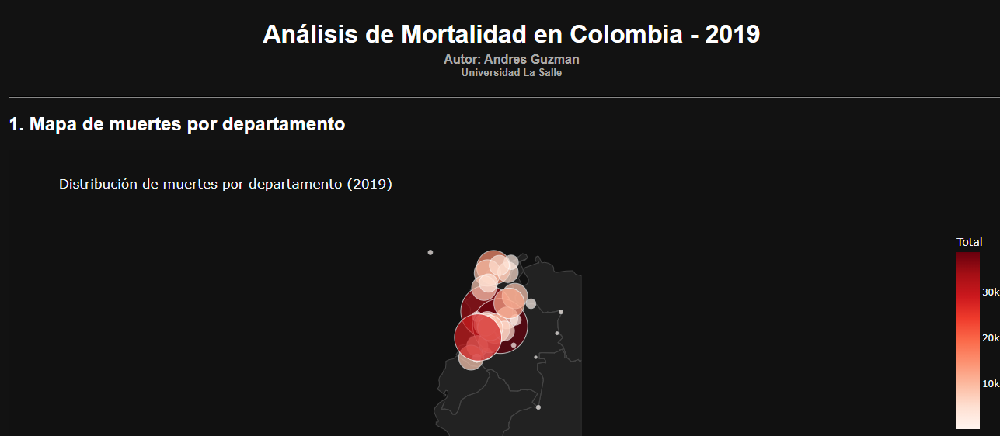
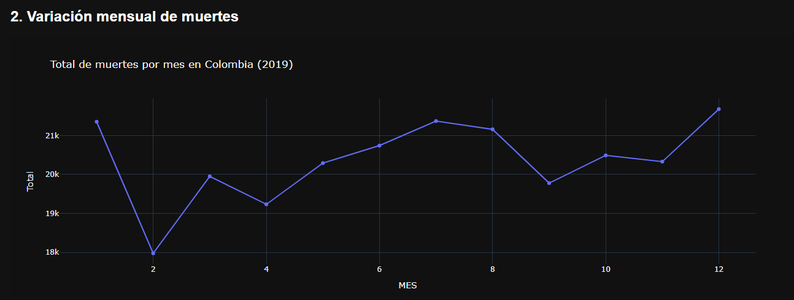
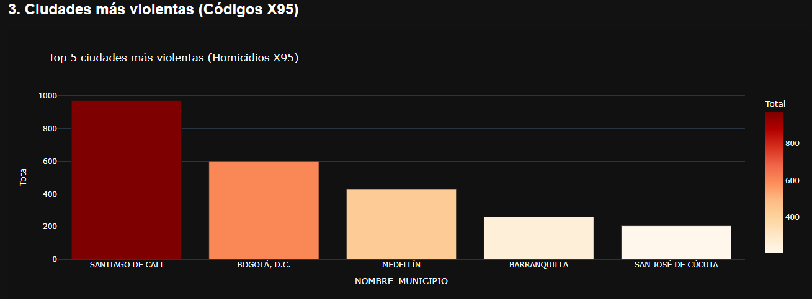
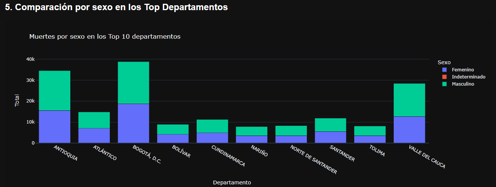
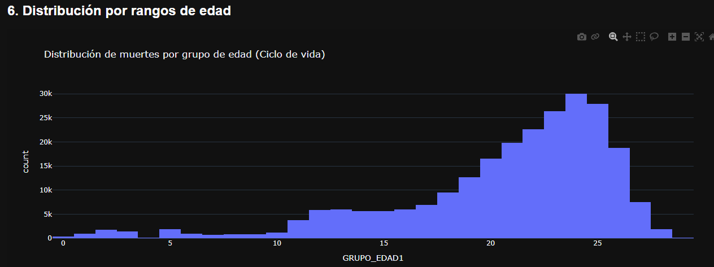
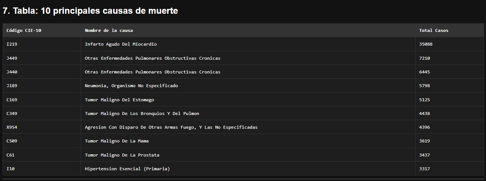

## Requisitos
- Python 3.10+ (probado con Python 3.15 en Windows)
- dash
- pandas
- plotly
- openpyxl
- gunicorn

## Despliegue en Render (PaaS)
1. Subir el proyecto a un repositorio público de GitHub.
2. Crear una cuenta en render.com y conectar el repositorio.
3. Crear un **Web Service** con la siguiente configuración:
   - **Build Command:** `pip install -r requirements.txt`
   - **Start Command:** `gunicorn app:server`
4. Render despliega automáticamente y entrega una URL pública (ej. `https://taller-mortalidad.onrender.com`).

## Software
- Python 3.15
- Dash
- Plotly
- Pandas
- Openpyxl
- Gunicorn

## Instalación local
```bash
git clone https://github.com/TU_USUARIO/taller-mortalidad-colombia.git
cd taller-mortalidad-colombia
pip install -r requirements.txt
python app.py
```

## Visualizaciones y resultados

### 1. Mapa de muertes por departamento

**Interpretación:** Los departamentos con mayor número de defunciones son Bogotá D.C., Antioquia y Valle del Cauca, lo que refleja la alta concentración poblacional y la mayor oferta de servicios de salud en estas zonas. El mapa de puntos (scatter geo) permite ubicar geográficamente cada departamento con el tamaño y color del punto proporcional al total de muertes.

### 2. Variación mensual de muertes

**Interpretación:** A lo largo de 2019 se observan picos de mortalidad en ciertos meses (especialmente enero y diciembre), posiblemente asociados a factores estacionales, enfermedades respiratorias y la mayor circulación de virus en épocas frías.

### 3. Ciudades más violentas (Homicidios X95)

**Interpretación:** Las ciudades con mayor índice de homicidios por arma de fuego (código X95 de la CIE-10) concentran problemáticas de seguridad focalizadas en las principales áreas metropolitanas del país. Se encontraron 9.273 registros con este código.

### 4. Ciudades con menor mortalidad

**Interpretación:** Los municipios con menor índice de mortalidad son en su mayoría zonas con baja densidad poblacional. Al graficar las 10 ciudades con menos muertes, cada una representa aproximadamente el 10% del total del gráfico, lo que indica que sus valores son casi idénticos entre sí (1 o 2 casos por municipio en todo el año). Esto resalta la diferencia abismal frente a grandes ciudades como Bogotá o Medellín.

### 5. Comparación por sexo en los Top Departamentos

**Interpretación:** Se evidencia una diferencia significativa entre géneros; la mortalidad es mayor en hombres que en mujeres en la mayoría de los departamentos analizados, lo que puede asociarse a factores de riesgo laboral, violencia y acceso diferencial a servicios de salud.

### 6. Distribución por rangos de edad

**Interpretación:** La mayor concentración de muertes se da en los grupos de edad de adultez intermedia y vejez, lo cual es esperado por el envejecimiento natural de la población y la mayor prevalencia de enfermedades crónicas en estos rangos.

### 7. Tabla de principales causas de muerte

**Interpretación:** Las enfermedades cardiovasculares (como el Infarto Agudo del Miocardio - I21) y respiratorias (como EPOC - J44) encabezan la lista de causas de mortalidad, superando ampliamente las causas externas. Esto confirma la transición epidemiológica hacia enfermedades no transmisibles en Colombia.
